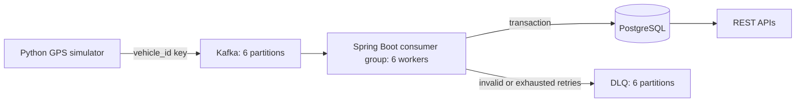

# Real-Time Transit Analytics

Java 17 / Spring Boot, Python, Kafka, PostgreSQL, Docker Compose. Verified local MVP. AWS is a proposed architecture only; optional examples have not been deployed or verified in AWS.



## Run

Requires Docker with Compose v2, approximately 4 GB available memory, and free ports 8080, 9092, 5432.

```sh
test -f .env || cp .env.example .env
docker compose up -d --build --wait
curl http://localhost:8080/actuator/health
curl http://localhost:8080/api/analytics/summary
```

Defaults: 250 events/sec, 100 vehicles, 10 routes. Configure `.env` before starting; recreate the simulator to apply rate changes. Ports bind to localhost. Named volumes preserve PostgreSQL and Kafka state. `docker compose down` stops services while preserving data; adding `--volumes` deletes data.

```sh
docker compose logs -f backend simulator
docker compose stop simulator
docker compose run --rm simulator python simulator.py --rate 250 --duration 30
docker compose start simulator
```

Do not run the continuous and one-off simulator together when measuring a target rate. A finite run reports delivered, failed, pending, elapsed time, and delivery rate; failed or undelivered messages produce a nonzero exit code. There is no local producer outbox: terminating the process forcibly can lose unflushed messages.

## Events

```json
{"event_id":"cdf14fd6-e8f8-4982-ab09-8442a0478138","vehicle_id":"vehicle-0001","route_id":"route-001","latitude":41.88,"longitude":-87.63,"speed":32.5,"timestamp":"2026-10-11T02:00:00Z"}
```

Coordinates are decimal degrees; speed is km/h; timestamps are UTC instants. Vehicles move along synthetic Chicago-area circular routes using elapsed time and smooth speed variation. These are plausible simulated tracks, not actual transit route geometry. IDs remain stable within a configured fleet; every event gets a UUID.

## APIs

```sh
curl 'http://localhost:8080/api/vehicles?limit=100&offset=0'
curl http://localhost:8080/api/vehicles/vehicle-0001/location
curl http://localhost:8080/api/routes/route-001/statistics
curl 'http://localhost:8080/api/routes/route-001/statistics?from=2026-10-11T01:00:00Z&to=2026-10-11T02:00:00Z'
curl http://localhost:8080/api/analytics/summary
```

| Endpoint | Result |
| --- | --- |
| `/api/vehicles` | Latest locations, ordered by vehicle ID; limit 1–1000, offset >= 0 |
| `/api/vehicles/{id}/location` | Latest location; unknown vehicle returns 404 |
| `/api/routes/{id}/statistics` | Event count, distinct vehicles, average/max speed, first/last event time |
| `/api/analytics/summary` | Total persisted events, vehicles, current routes, average latest speed, vehicles active within five minutes, latest event time |

Route windows are `[from,to)`, default to the last hour, and must be positive and at most 24 hours. Empty windows return zero counts and null speed/time aggregates. Invalid parameters return 400. Average route speed is an event-weighted average; average summary speed uses one latest sample per vehicle. Summary total routes uses vehicles' latest assigned routes.

## Reliability and design

- Producer: `acks=all`, idempotence, delivery callbacks, bounded delivery timeout, queue backpressure, and graceful flushing. Keys are vehicle IDs, preserving per-vehicle order within Kafka partitions.
- Consumer: stable `transit-persistence` group, six workers, auto commits disabled, manual immediate acknowledgment only after the transactional repository returns. A crash between database commit and offset commit causes replay.
- PostgreSQL UUID primary key and `ON CONFLICT DO NOTHING` make replay idempotent. Event insertion and latest-location update share one transaction. Latest location compares `(event_time,event_id)` so late arrivals cannot overwrite newer locations; UUID breaks timestamp ties deterministically. First payload wins for a reused UUID.
- Invalid JSON, missing/invalid fields, non-finite numbers, and mismatched vehicle keys go directly to DLQ. Other processing failures get five exponential retries (1, 2, 4, 8, 10 seconds). After exhaustion they go to DLQ, so a long database outage requires DLQ replay. DLQ keeps the original key/value, source partition, and exception headers.
- A recovered offset is committed only after confirmed DLQ publication. Failed DLQ publication leaves the source record retryable. Kafka and PostgreSQL are separate transactions: DLQ copies can be duplicated after a crash, while database persistence remains idempotent.
- Flyway owns schema creation. Vehicle/time and route/time indexes support history queries; a separate latest-location table keeps vehicle lookups independent of history size. Route aggregation is bounded; exact total event count still scans the event table/index and is intended for this MVP.
- Compose uses one Kafka broker with replication factor 1. `acks=all` cannot protect against loss of that broker's disk. Local volumes are persistent, but this is not a high-availability deployment. Kafka defaults retain events for seven days; PostgreSQL history has no automatic retention yet.
- No authentication or TLS in the local MVP. Before external deployment, add access controls, multiple brokers, monitoring, retention, and secret management. Cloud deployment is deferred; the optional AWS examples are unverified.

## Tests

Java 17 and Maven are required for host unit tests; simulator unit tests need only Python's standard library. End-to-end tests need the healthy Compose stack and host Python 3. They pause the simulator, restart backend/PostgreSQL, add isolated test vehicles/routes, and resume services on exit. Run against local development data.

```sh
mvn -f backend/pom.xml test
python3 -m unittest discover -s tests -p 'test_*.py'
python3 tests/integration.py
```

The Java suite validates fields, malformed input, vehicle key matching, acknowledgment order, and failure/retry behavior. End-to-end tests verify duplicate suppression, out-of-order locations, REST responses and aggregates, invalid-event DLQ headers, consumption after restart, recovery from a short PostgreSQL outage, and complete persistence of a paced throughput workload. Results are written to ignored `benchmark-results.json`.

## Measured benchmark

Local Docker Desktop, ARM64 macOS, Java 17 container, single Kafka broker and PostgreSQL 16; measured October 10, 2026. One 10-second run with 100 vehicles:

| Measurement | Observed |
| --- | --- |
| Requested rate | 250 events/sec |
| Produced and persisted | 2,500 / 2,500 |
| Producer duration | 10.0018 sec |
| End-to-end duration | 10.7374 sec |
| End-to-end persisted rate | 232.83 events/sec |

End-to-end timing includes one-off container startup, producer delivery, API polling, and waiting for all 2,500 unique events to appear in PostgreSQL. This confirms full persistence at a paced 250 events/sec input; it is not a maximum-capacity or long-duration benchmark. Five Java tests, two Python tests, and the end-to-end checks passed. Re-run the benchmark on your machine rather than treating these observations as a throughput guarantee.

## Proposed AWS architecture (optional, not deployed)

A possible extension would run the existing Compose stack on EC2, archive committed PostgreSQL telemetry as gzip JSONL in S3, and use EMR Serverless for daily route statistics written as Parquet. The working local system does not depend on AWS, cloud credentials, boto3, or Spark.

The `aws/` directory retains optional deployment, exporter, IAM, systemd, cleanup, and PySpark examples for discussion. No AWS resources have been provisioned and no paid jobs have been submitted. Local unit tests of those examples do not establish cloud deployment readiness. Known readiness gaps include exporter virtualenv permissions, cleanup aborting before EC2 termination on EMR errors, duplicate job submissions, and unverified memory limits/application startup. These examples are not deployment-ready and were left unchanged when finalizing the local project.
